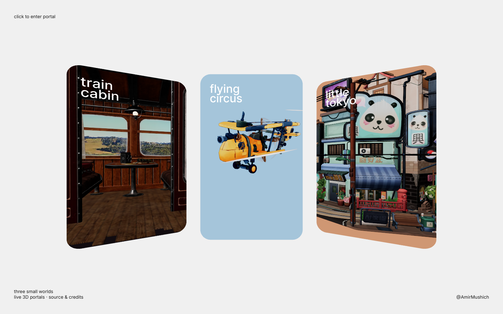

# Three Small Worlds

Three animated scenes behind live 3D portal cards. Click a card to move the camera into its world, explore, then return to the overview.

[Try the live demo](https://three-small-worlds.vercel.app/) · [Build your own](#build-your-own) · [Credits](#credits)



## Build your own

Open this repository in Codex or Claude Code and paste:

> Run this project locally and show me the working example. Then help me replace its three scenes with my own GLB models. Handle setup and verification, preserve credits and licenses, and ask me for the files and visual choices you need. Keep everything local until I ask you to publish.

Agent instructions are in [AGENTS.md](AGENTS.md), [CLAUDE.md](CLAUDE.md) and the [implementation guide](docs/AGENT-GUIDE.md). The agent should run the included example before adapting it to your material.

## Controls

- Click a portal to enter its animated scene.
- Drag to move the camera and use the wheel to change distance.
- Select **back** or press **Escape** to return.
- Keys **1**, **2** and **3** select the train, airplane and Tokyo scenes.

## Run directly

Requires Node.js 22.12 or newer.

```sh
npm ci --ignore-scripts
npm run dev
```

Open the loopback URL printed by Vite. To build and preview:

```sh
npm run build
npm run preview
```

Windows users can build once, then double-click **START.cmd** to serve that build; **STOP.cmd** stops its server. Details are in [LOCAL-START.md](LOCAL-START.md).

## Change the scenes

Edit [src/scenes.js](src/scenes.js) to replace models, labels, backgrounds, card placement and model transforms. Put your GLBs in `public/models/`. Embedded animation clips play automatically; static models stay static.

The portal blend, camera transition and controls are in [src/main.jsx](src/main.jsx). The same animated scene stays mounted while entering and leaving. Models, fonts and the Draco decoder are served from the application itself.

This is an experimental desktop-first study. Narrow screens crop the side cards. Mobile performance depends on the device and models; a complete accessible alternative to the WebGL scenes is not included.

## Deploy

Import your fork into Vercel. The included `vercel.json` selects Vite, runs `npm run build` and serves `dist/`. Other static hosts can serve the same directory. No API keys or backend are required.

## Credits

Based on the [pmndrs Enter portals example](https://pmndrs.github.io/examples/enter-portals/), credited to Paul Henschel / drcmda. Included scenes are by **thomas.rynne**, **Mikkel Garde Blaase / plorigon** and **Glen Fox / glenatron**. Full source links and notices are in [CREDITS.md](CREDITS.md).

The application code is MIT licensed. Models retain their own licenses: the airplane is **CC BY-NC 4.0**; the train and Tokyo scenes are **CC BY 4.0**. Use assets licensed for your intended use when building a commercial adaptation.

Presented by [@AmirMushich](https://x.com/amirmushich).
